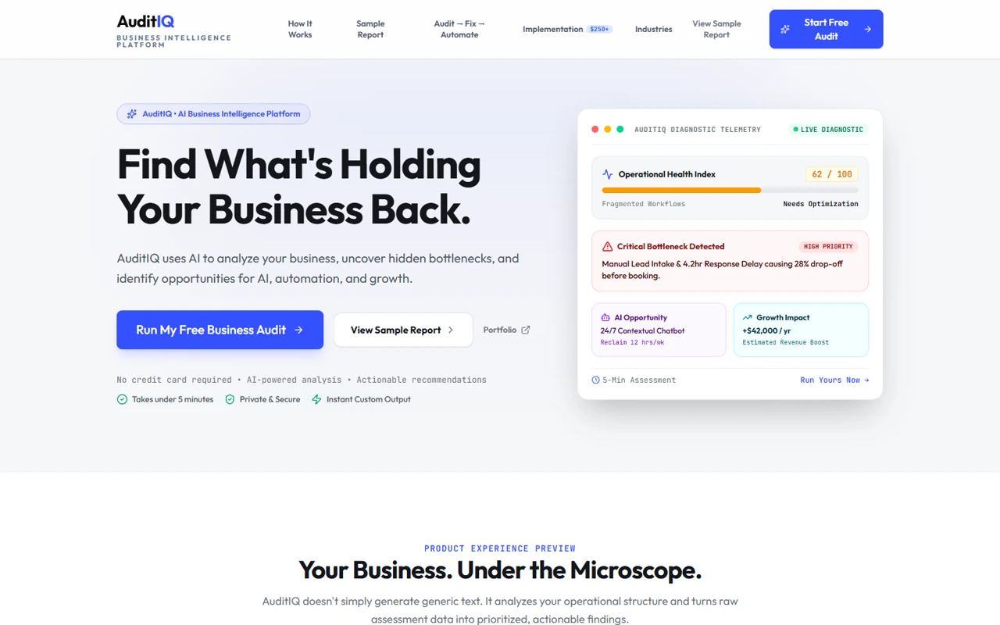

# Hi, I'm Alonigbeja Muhsin 👋
### `MSL AI Systems` · AI Systems Builder

AI Systems Builder and Founder of **MSL AI Systems** building and shipping AI-powered web applications, business intelligence platforms, and automated workflow systems. B.Sc. Computer Science graduate from Crescent University Abeokuta, Nigeria.

<p align="left">
  <a href="https://x.com/AlonigbejaM"></a>
  <a href="https://www.linkedin.com/in/alonigbeja-muhsin/"></a>
  <a href="https://www.tiktok.com/@muhsinlabs"></a>
  <a href="https://www.instagram.com/ibnal_kabeer/"></a>
  <a href="https://wa.me/2347079731073"></a>
</p>

---

## 🛠️ Tech Stack

**Frontend**


**Backend, Data & Machine Learning**


**AI & Workflow Automation**


**Deployment & Tools**


---

## 👨‍💻 About Me

```
  muhsin@github ~ whoami
```

```js
// AI Systems Builder & Founder, MSL AI Systems
const muhsin = {
  name:     "Alonigbeja Muhsin Adebayo",
  company:  "MSL AI Systems",
  role:     "AI Systems Builder",
  location: "Nigeria",
  stack:    ["Python", "TypeScript", "React", "Node.js", "PostgreSQL", "n8n", "LLMs"],
  building: ["AuditIQ", "FolaNova", "Data Poisoning Detection", "MSL Signal Bot", "CPA Conversion Bot"],
  focus:    "Turning operational bottlenecks into automated AI software.",
};
```

---

## ⭐ Featured Project

### [AuditIQ](https://auditiq.ai.studio) · AI Business Intelligence & Readiness Platform
**[Live](https://auditiq.ai.studio) · [Portfolio](https://github.com/Ibnalkabeer)**



An AI-powered business intelligence and diagnostic platform built with React, TypeScript, Tailwind CSS, and LLM integrations, designed to evaluate business health, AI readiness, operational bottlenecks, and high-ROI automation opportunities.

AuditIQ replaces guesswork with a structured 4-step diagnostic assessment that scores a company across core operational pillars, identifies repetitive manual workflows, and generates a tailored implementation blueprint and action roadmap for AI transformation.

---

## 🚀 Other Projects

| Project | Description | Status | Links |
|---|---|---|---|
| **FolaNova** | Modern luxury storefront and curated catalog powered by the Shopify Storefront GraphQL API, featuring an AI shopping concierge and direct WhatsApp checkout integration. | `live` | [Live](https://folanova.ai.studio/) · [GitHub](https://github.com/Ibnalkabeer) |
| **Data Poisoning Detection** | Adversarial ML detection system for a simulated 10-client federated learning environment on Fashion-MNIST (Random Forest F1=0.72, ROC-AUC=0.75) paired with an interactive React/TypeScript research dashboard. | `live` | [Live](https://data-poisoning-detection.vercel.app/) · [Repo](https://github.com/Ibnalkabeer/data-poisoning-detection) |
| **MSL Signal Automation Bot** | Automated Python market signal engine and WebSocket processor that evaluates trading setups, tracks scheduled performance metrics, and dispatches real-time alerts via Telegram. | `live` | [Repo](https://github.com/Ibnalkabeer/MSL-ACADEMY-BOT) |
| **CPA Conversion & OCR Bot** | Stateful 9-stage Telegram conversion bot built with TypeScript, Telegraf, SQLite, BullMQ, and Tesseract.js OCR for automated lead onboarding and deposit receipt verification (262 passing tests). | `ongoing` | [GitHub](https://github.com/Ibnalkabeer) |
| **AI Lead Automation System** | Multi-channel business workflow built in n8n that captures leads from forms and webhooks, qualifies intent with LLMs, updates Notion CRM, and dispatches instant WhatsApp follow-ups. | `shipped` | [Portfolio](https://github.com/Ibnalkabeer) |

---

## 📊 GitHub Stats

[](https://git.io/streak-stats)

---

## 📫 Reach Me

- **Email:** [muhsinalonigbeja@gmail.com](mailto:muhsinalonigbeja@gmail.com)
- **X (Twitter):** [@AlonigbejaM](https://x.com/AlonigbejaM)
- **LinkedIn:** [alonigbeja-muhsin](https://www.linkedin.com/in/alonigbeja-muhsin/)
- **TikTok:** [@muhsinlabs](https://www.tiktok.com/@muhsinlabs)
- **Instagram:** [@ibnal_kabeer](https://www.instagram.com/ibnal_kabeer/)
- **WhatsApp:** [+234 707 973 1073](https://wa.me/2347079731073)
